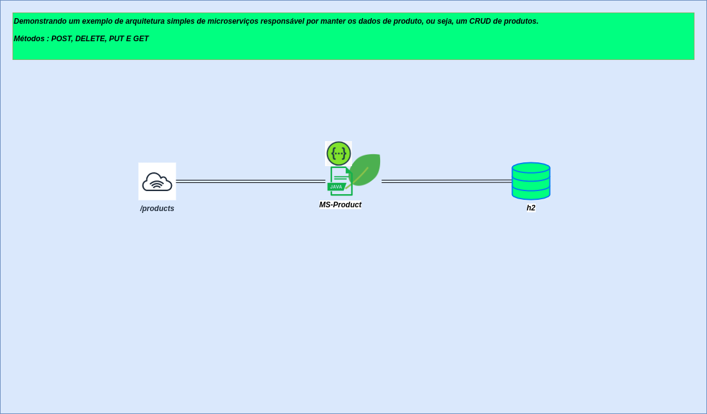

# Product Center (CRUD de produtos)

API REST de produtos com Spring Boot 2.6, Java 11 e banco H2 em memória. Feita num programa de bolsa,
como projeto de estudo.



## Rodar

```bash
./mvnw spring-boot:run
```

A API sobe em http://localhost:8080. O console do H2 fica em `/h2-console`
(JDBC URL `jdbc:h2:mem:api-products`, usuário `sa`, sem senha).

## Endpoints

| Método | Rota | O que faz |
|---|---|---|
| GET | `/products` | Lista os produtos |
| GET | `/products/search?q=&minPrice=&maxPrice=` | Busca por texto e faixa de preço, paginada |
| GET | `/products/{id}` | Mostra um produto |
| POST | `/products` | Cria |
| PUT | `/products/{id}` | Atualiza |
| DELETE | `/products/{id}` | Apaga |

Contrato completo em [`swagger.yaml`](swagger.yaml).
